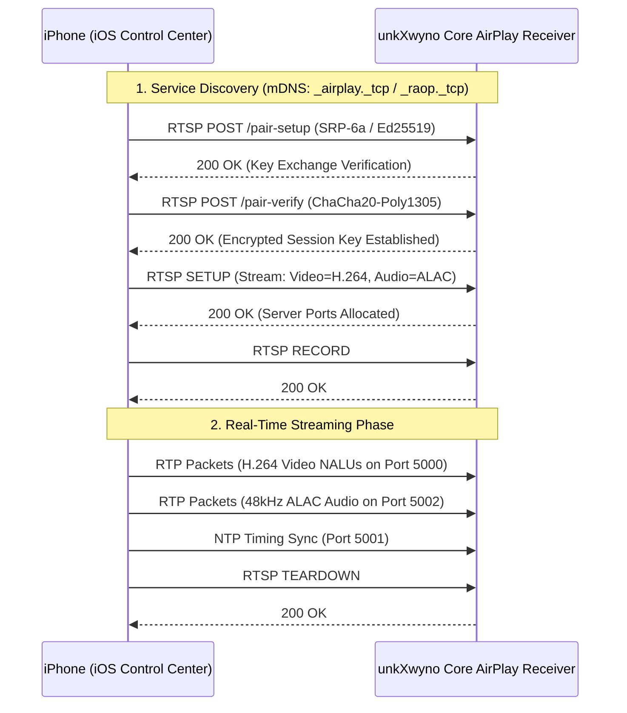

# unkXwyno Mirror: iOS usbmuxd & AirPlay Mirroring Specification

**Protocol**: Apple `usbmuxd` (Wired USB) & AirPlay Mirroring (RTSP / RTP)  
**Receiver Name**: `"unkXwyno Mirror"`  
**Service Announcements**: `_airplay._tcp`, `_raop._tcp`  
**Web URI**: `https://unkxwyno-mirror.genzhost.best`

---

## 1. Overview
iOS screen mirroring operates completely out-of-the-box without requiring any app or profile installation on the iPhone or iPad.

The user simply opens **iOS Control Center**, taps **Screen Mirroring**, and selects **"unkXwyno Mirror"**.

For **Wired USB Mirroring**, Apple's `usbmuxd` (USB Multiplexor) protocol is utilized directly over the lightning / USB-C cable to establish a dedicated, zero-interference virtual TCP tunnel.

---

## 2. Wired USB Transport: Native usbmuxd Protocol

When an iOS device connects to the host PC via USB:
1. Device enumerates with Apple Vendor ID `0x05AC`.
2. The host engine connects to the `usbmuxd` socket (or claims the USB bulk endpoints directly).

### usbmuxd Message Header
Every packet over the usbmuxd stream begins with a **16-byte header**:

```
 0                   1                   2                   3
 0 1 2 3 4 5 6 7 8 9 0 1 2 3 4 5 6 7 8 9 0 1 2 3 4 5 6 7 8 9 0 1
+-+-+-+-+-+-+-+-+-+-+-+-+-+-+-+-+-+-+-+-+-+-+-+-+-+-+-+-+-+-+-+-+
|                      Total Packet Length                      |
|                         (32 bits, LE)                         |
+-+-+-+-+-+-+-+-+-+-+-+-+-+-+-+-+-+-+-+-+-+-+-+-+-+-+-+-+-+-+-+-+
|                       Protocol Version                        |
|               (1 = Binary, 2 = XML/Binary Plist)              |
+-+-+-+-+-+-+-+-+-+-+-+-+-+-+-+-+-+-+-+-+-+-+-+-+-+-+-+-+-+-+-+-+
|                          Message Type                         |
|     (1 = Result, 2 = Connect, 3 = Listen, 4 = DeviceAdd, ...) |
+-+-+-+-+-+-+-+-+-+-+-+-+-+-+-+-+-+-+-+-+-+-+-+-+-+-+-+-+-+-+-+-+
|                           Tag / Seq                           |
+-+-+-+-+-+-+-+-+-+-+-+-+-+-+-+-+-+-+-+-+-+-+-+-+-+-+-+-+-+-+-+-+
```

### Protocol Sequence
1. **Listen for Attached iOS Devices**:
   - Host sends `MessageType = 3` (`Listen`).
   - usbmuxd responds with `DeviceAdd` containing the `DeviceID`, `ProductID`, and `SerialNumber`.
2. **Connect to Device AirPlay Service**:
   - Host sends `MessageType = 2` (`Connect`) with target `Port = 0x1389` (5000 in network byte order).
   - Once connected, raw RTSP / RTP streaming operates through the USB pipe identically to an ultra-fast Ethernet socket.

---

## 3. AirPlay RTSP Handshake & RTP Video/Audio Stream



### Video Depacketization
- Video payload arrives inside standard RTP packets (Payload Type 96).
- RTP header contains timestamp, sequence, and marker bit.
- The payload contains Annex-B H.264 NAL units (SPS, PPS, IDR, Slices) that are passed directly into the OS hardware decoder (`D3D11VA` on Windows, `VideoToolbox` on macOS).
