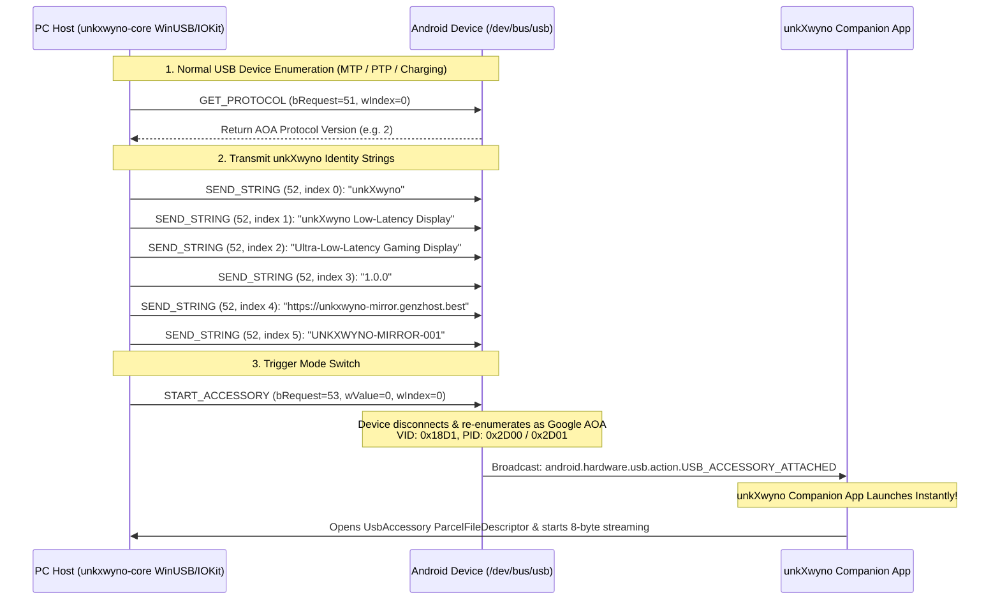

# unkXwyno Mirror: Android Open Accessory 2.0 (AOA2) Handshake Specification

**Protocol Version**: `AOA 2.0`  
**Target Package**: `best.genzhost.unkxwynomirror`  
**Web URI**: `https://unkxwyno-mirror.genzhost.best`

---

## 1. Overview
The Android Open Accessory (AOA) protocol allows a USB host (PC running `unkxwyno-core`) to act as the USB host controller and switch an Android device into **Accessory Mode**.

**Key Advantage**: Zero developer mode required. Casual users do not need to enable USB Debugging or install ADB drivers.

---

## 2. AOA2 USB Handshake Protocol Sequence

When an Android phone is physically connected via USB:



### 2.1 Low-Level USB Control Transfers

The host sends standard USB Control Transfers on Endpoint 0:

```c
/* Request Codes */
#define AOA_GET_PROTOCOL    51
#define AOA_SEND_STRING     52
#define AOA_START_ACCESSORY 53
#define AOA_REGISTER_HID    54
#define AOA_SET_HID_REPORT  56

/* Control Transfer bmRequestType */
#define USB_DIR_IN          0x80
#define USB_DIR_OUT         0x00
#define USB_TYPE_VENDOR     0x40
#define USB_RECIP_DEVICE    0x00
```

1. **Query Protocol Support**:
   - `bmRequestType = 0xC0` (`USB_DIR_IN | USB_TYPE_VENDOR | USB_RECIP_DEVICE`)
   - `bRequest = 51`
   - `wValue = 0`
   - `wIndex = 0`
   - Buffer: `uint16_t protocol_version` (Little-Endian). Must be $\ge 2$.

2. **Send Identification Strings**:
   - `bmRequestType = 0x40` (`USB_DIR_OUT | USB_TYPE_VENDOR | USB_RECIP_DEVICE`)
   - `bRequest = 52`
   - `wIndex = String Index` (0..5):
     - `0`: Manufacturer = `"unkXwyno"`
     - `1`: Model Name = `"unkXwyno Low-Latency Display"`
     - `2`: Description = `"Ultra-Low-Latency Gaming Display"`
     - `3`: Version = `"1.0.0"`
     - `4`: URI = `"https://unkxwyno-mirror.genzhost.best"`
     - `5`: Serial Number = `"UNKXWYNO-MIRROR-001"`
   - Buffer: Zero-terminated UTF-8 string bytes.

3. **Trigger Accessory Mode Re-enumeration**:
   - `bmRequestType = 0x40`
   - `bRequest = 53`
   - `wValue = 0`, `wIndex = 0`, `wLength = 0`.

---

## 3. Sub-1ms Hardware Input: AOAv2 USB HID Registration

In addition to bulk streaming, AOA 2.0 allows the host PC to register simulated USB HID input devices directly on the Android device kernel over the USB control pipe.

1. **Register HID Multi-Touch Device**:
   - `bRequest = 54` (`AOA_REGISTER_HID`)
   - `wValue = HID Device ID` (e.g. `1`)
   - `wIndex = Descriptor Length`
2. **Send HID Report Descriptor**:
   - Transmits standard Windows/Android USB Digitizer descriptor:
     - Usage Page: `0x0D` (Digitizer)
     - Usage: `0x04` (Touch Screen)
     - Multi-touch contact points (X, Y, Tip Switch, Contact Identifier).
3. **Dispatch Real-Time Touch Reports**:
   - `bRequest = 56` (`AOA_SET_HID_REPORT_DESC`)
   - Directly injects hardware touch events with latency $< 0.8\text{ ms}$, entirely bypassing Android accessibility services and ADB shell overhead.
